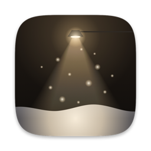

<p align="center">
  
</p>

<h1 align="center">Snowdrift</h1>

<p align="center">It's snowing on your desktop.</p>

<p align="center">
  <a href="https://github.com/kirDima-787/Snowdrift/releases/latest/download/Snowdrift-Setup.exe"><b>Download for Windows</b></a>
  &nbsp;·&nbsp;
  <a href="https://github.com/kirDima-787/Snowdrift/releases/latest/download/Snowdrift.dmg"><b>Download for macOS</b></a>
  &nbsp;·&nbsp;
  <a href="https://github.com/kirDima-787/Snowdrift/releases/latest"><b>All Releases</b></a>
  <br>
  <sub>Windows 10 or 11 · macOS 14 or later · Linux · free and open source</sub>
</p>

https://github.com/user-attachments/assets/291c3cd5-3563-4b86-8b66-dfd924f980fc

A lightweight desktop app that brings gentle snowfall to your screen. Soft snow drifts across your displays, settles along the tops of your windows, and slips off when you drag them. Sweep the drift aside with your cursor.

## What the snow does

- **Falls.** Every flake keeps its own pace and sways in a slow breeze. Variable mode lets the snowfall rise and ease on its own throughout the day.
- **Settles.** It piles up and slumps to a natural slope along the bottom of the screen, on the taskbar, and on any open window with room above it.
- **Moves.** Push the cursor through a drift and it parts and sprays. Drag or shake a window and its snow slides off and lands below.
- **Drops.** Close or minimize a window and its snow drops at once, bursting into powder where it lands.
- **Melts.** With Melt Snow on, drifts thaw slowly so they never take over your screen.
- **Hides.** Screenshots and screen sharing can show your desktop without it, unless you turn on Show in Screenshots.
- **Rests.** Uses minimal hardware resources with Direct3D 11 / Metal rendering, automatically pausing when displays sleep or lock.

## Tray & Menu controls

All settings are available directly from the liquid-glass tray menu on Windows and menu bar on macOS:

- **Snowfall:** Intensity options (Off, Light, Steady, Heavy, Variable).
- **Accumulate:** Toggle piling snow into realistic drifts.
- **Melt Snow:** Gradually melt settled snow over time.
- **Snow on Windows:** Allow flakes to gather on top of active application windows.
- **Clear Snow:** Instantly sweep all snow from the screen.
- **Behind Windows:** Keep snowfall behind windows, directly on top of the wallpaper.
- **Show in Screenshots:** Include or exclude snow from system screenshots and screen captures.
- **Open at Login:** Automatically start Snowdrift when you log in.
- **Language:** Switch interface language (English / Russian).
- **Check for Updates:** Check for new releases and update with one click.

## Building from source

### Windows
```sh
cargo build --release --bin Snowdrift
```

### macOS
```sh
./build-macos.sh
```

### Linux
```sh
cargo build --release --bin Snowdrift
```

---

## Русская версия

Snowdrift — красивый и легковесный падающий снег на рабочем столе для Windows, macOS и Linux.

Снежинки мягко кружатся на экране, оседают на панели задач и верхних гранях открытых окон, тают со временем и разлетаются в стороны при движении курсора мыши.

### Основные возможности

- **Физика сугробов:** Снег ложится на поверхности с естественным углом откоса.
- **Интерактивность:** Курсор разгребает сугробы, а перемещение или закрытие окон стряхивает скопившийся снег вниз.
- **Жидкое стекло:** Меню управления и уведомления об обновлениях выполнены в стиле Liquid Glass с размытием фона и плавной анимацией.
- **Двуязычный интерфейс:** Полная поддержка русского и английского языков с переключением в один клик.
- **Автообновление:** Проверка и установка новых версий прямо через системное уведомление.

## License

[MIT](LICENSE)
